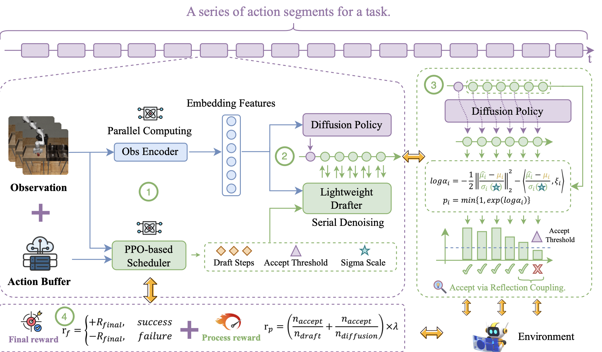
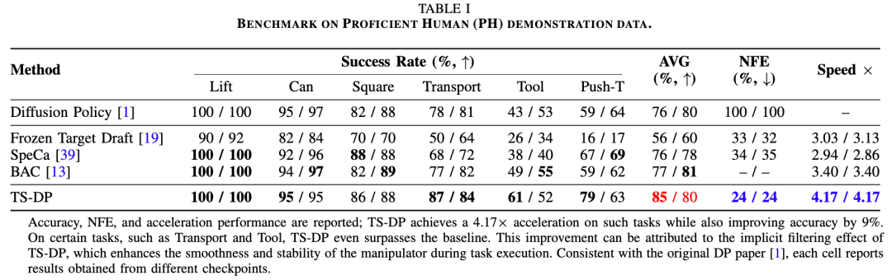
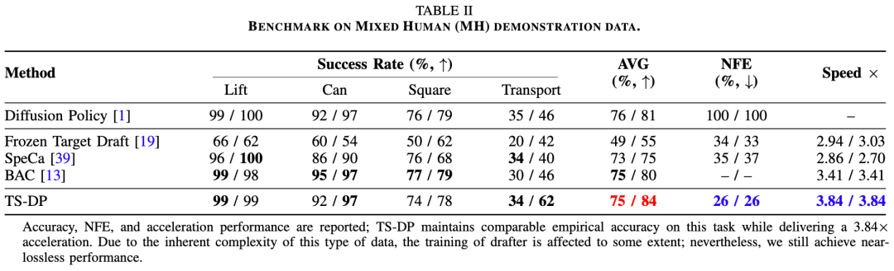

<div align="center">

# TS-DP: Reinforcement Speculative Decoding for Temporal Adaptive Diffusion Policy Acceleration

Ye Li, Jiahe Feng, Yuan Meng, Kangye Ji, Chen Tang, Jiajun Fan, Xinwan Wen, Jiawei Li, Wenwu Zhu, Shu-Tao Xia, Xin Wang, Zhi Wang

[](https://arxiv.org/abs/2512.15773)
[](https://huggingface.co/childtang/TS-DP)
[](LICENSE)
[](conda_environment.yaml)

</div>

This repository contains the official inference and evaluation code of **TS-DP**
(**T**emporal-aware Reinforcement-based **S**peculative **D**iffusion **P**olicy).

Diffusion Policy (DP) performs well in embodied control, but its iterative denoising
makes inference slow. We observe that DP inference is *I/O bound*, not
computation-bound, which makes speculative decoding a natural fit. TS-DP is the
first framework to bring speculative decoding with temporal adaptivity to DP:

- **Drafter.** A lightweight one-block Transformer drafter, distilled from the
  base model, proposes several denoising steps. The base model then verifies all
  of them in a single parallel pass.
- **RL scheduler.** A PPO-based scheduler watches the task as it runs and adjusts
  the speculative parameters (draft steps, acceptance threshold and sigma scale)
  to the current task difficulty.

TS-DP reaches up to **4.17×** faster inference in simulation, with a draft
acceptance rate above **85%**. On real robots it runs at **26 Hz** with a
**3.8×** speedup and success rates comparable to the base model.

<p align="center">
  
</p>

## Contents

- [Results](#results)
- [Installation](#installation)
- [Data and Checkpoints](#data-and-checkpoints)
- [Evaluation](#evaluation)
- [Code Structure](#code-structure)
- [Citation](#citation)
- [Acknowledgements](#acknowledgements)
- [License](#license)

## Results

Main results on the simulation benchmarks, taken from the paper:

<p align="center">
  
</p>

<p align="center">
  
</p>

> [!NOTE]
> Diffusion sampling and the simulators are stochastic, and floating-point
> behavior differs across GPUs and drivers. Results reproduced on a different
> machine may therefore deviate slightly from the numbers reported in the paper.

Please refer to the paper for the multi-stage tasks (Kitchen and Block Pushing),
the latency analysis and the real-world experiments.

## Installation

The code has been tested on Linux with NVIDIA GPUs, and the environment follows
[Diffusion Policy](https://github.com/real-stanford/diffusion_policy).

```bash
git clone https://github.com/ChildTang/TS-DP.git
cd TS-DP

# MuJoCo system dependencies
sudo apt install -y libosmesa6-dev libgl1-mesa-glx libglfw3 patchelf

# Conda environment (Mambaforge recommended; `conda env create` also works)
mamba env create -f conda_environment.yaml
conda activate robodiff
```

On a headless machine, render with EGL:

```bash
export MUJOCO_GL=egl
```

## Data and Checkpoints

Run all commands from the repository root. The environment runners read the
initial conditions of every task from the simulation datasets through relative
paths under `data/`.

### 1. Simulation datasets

Download the datasets released by Diffusion Policy:

```bash
mkdir -p data && cd data
for f in robomimic_image pusht kitchen block_pushing; do
  wget https://diffusion-policy.cs.columbia.edu/data/training/$f.zip
  unzip $f.zip && rm -f $f.zip
done
cd ..
```

`robomimic_image.zip` is about 78 GB. Afterwards, the layout should look like this:

```
data/
├── robomimic/datasets/{lift,can,square,transport,tool_hang}/{ph,mh}/image_abs.hdf5
├── pusht/pusht_cchi_v7_replay.zarr
├── kitchen/
└── block_pushing/
```

### 2. Base models (Diffusion Policy)

TS-DP accelerates the official Diffusion Policy transformer checkpoints without
modifying them. Download them from the
[Diffusion Policy experiment logs](https://diffusion-policy.cs.columbia.edu/data/experiments/)
into `data/checkpoints/`, keeping the original layout:

```bash
wget --recursive --no-parent --no-host-directories --cut-dirs=2 \
  --reject="index.html*" -P data/checkpoints \
  https://diffusion-policy.cs.columbia.edu/data/experiments/image/can_ph/diffusion_policy_transformer/
```

Repeat for each task in the table below.

### 3. TS-DP weights

The TS-DP drafters and schedulers are hosted on Hugging Face at
[childtang/TS-DP](https://huggingface.co/childtang/TS-DP) (12 settings, about 230 MB in total):

```bash
pip install -U huggingface_hub
hf download childtang/TS-DP --local-dir data/ts_dp                    # all settings
hf download childtang/TS-DP --include "can/*" --local-dir data/ts_dp  # a single setting
```

With older versions of `huggingface_hub`, use `huggingface-cli download` instead
of `hf download`. The files can also be downloaded directly, e.g.
`https://huggingface.co/childtang/TS-DP/resolve/main/can/drafter.ckpt`.

Each setting is a pair of files under `data/ts_dp/<name>/`:

```
data/ts_dp/<name>/
├── drafter.ckpt     # distilled drafter
└── scheduler.pth    # PPO scheduler
```

A drafter is distilled from one specific base model, so it only works with the
base model listed for it below.

| `<name>` | `--task` | Base model (under `data/checkpoints/`) |
| --- | --- | --- |
| `lift` | `lift` | `image/lift_ph/diffusion_policy_transformer/train_0/checkpoints/latest.ckpt` |
| `can` | `can` | `image/can_ph/diffusion_policy_transformer/train_0/checkpoints/latest.ckpt` |
| `square` | `square` | `image/square_ph/diffusion_policy_transformer/train_0/checkpoints/latest.ckpt` |
| `transport` | `transport` | `image/transport_ph/diffusion_policy_transformer/train_0/checkpoints/latest.ckpt` |
| `tool_hang` | `tool_hang` | `image/tool_hang_ph/diffusion_policy_transformer/train_0/checkpoints/epoch=0100-test_mean_score=0.773.ckpt` |
| `pusht` | `pusht` | `image/pusht/diffusion_policy_transformer/train_1/checkpoints/latest.ckpt` |
| `lift_mh` | `lift` | `image/lift_mh/diffusion_policy_transformer/train_0/checkpoints/latest.ckpt` |
| `can_mh` | `can` | `image/can_mh/diffusion_policy_transformer/train_0/checkpoints/latest.ckpt` |
| `square_mh` | `square` | `image/square_mh/diffusion_policy_transformer/train_0/checkpoints/latest.ckpt` |
| `transport_mh` | `transport` | `image/transport_mh/diffusion_policy_transformer/train_0/checkpoints/latest.ckpt` |
| `kitchen` | `kitchen` | `low_dim/kitchen/diffusion_policy_transformer/train_1/checkpoints/epoch=2700-test_mean_score=0.574.ckpt` |
| `block_pushing` | `block_pushing` | `low_dim/block_pushing/diffusion_policy_transformer/train_0/checkpoints/latest.ckpt` |

## Evaluation

### Single task

```bash
python scripts/eval_scheduler.py --task can \
    --checkpoint data/checkpoints/image/can_ph/diffusion_policy_transformer/train_0/checkpoints/latest.ckpt \
    --drafter-checkpoint data/ts_dp/can/drafter.ckpt \
    --ppo-checkpoint data/ts_dp/can/scheduler.pth \
    --output-dir data/eval/can \
    --device cuda:0
```

The MH tasks use the same `--task` as their PH counterparts, with the MH base
model and weights:

```bash
python scripts/eval_scheduler.py --task can \
    --checkpoint data/checkpoints/image/can_mh/diffusion_policy_transformer/train_0/checkpoints/latest.ckpt \
    --drafter-checkpoint data/ts_dp/can_mh/drafter.ckpt \
    --ppo-checkpoint data/ts_dp/can_mh/scheduler.pth \
    --output-dir data/eval/can_mh \
    --device cuda:0
```

| Argument | Description |
| --- | --- |
| `--task` | `lift`, `can`, `square`, `transport`, `tool_hang`, `pusht`, `kitchen`, `block_pushing` |
| `--checkpoint` | base Diffusion Policy checkpoint |
| `--drafter-checkpoint` | TS-DP drafter |
| `--ppo-checkpoint` | TS-DP scheduler |
| `--output-dir` | where results are written |
| `--n-parallel-envs` | episodes run in parallel (default 28) |
| `--task-indices` | evaluate only these initial conditions (default: all) |
| `--verbose` | print every scheduler decision |

### All tasks

```bash
bash scripts/eval_all.sh                     # all 12 settings
bash scripts/eval_all.sh can can_mh kitchen  # a subset
```

The paths can be overridden with environment variables, for example
`CKPT=... TSDP=... OUT=... DEVICE=cuda:1 N_PARALLEL=14 bash scripts/eval_all.sh`.

### Evaluation protocol and outputs

Each task is evaluated on all initial conditions of the Diffusion Policy
benchmark: the training-set states and the random test seeds stored in the base
model checkpoint. Every parallel episode holds its own copy of the policy on the
GPU, which takes about 1.2 GB for the image tasks. Reduce `--n-parallel-envs`
on smaller GPUs.

Results are saved to `<output-dir>/eval_<task>.json`:

- `summary`: metrics over all, training and test episodes, including:
  - task success: `task_success`; `task_max_reward` (coverage) for Push-T; `p_1`–`p_4` for Kitchen; `p_1`, `p_2` for Block Pushing;
  - speculative decoding statistics: accepted and proposed drafts, accepted drafts per inference, and number of policy calls.
- `episodes`: per-episode results, together with the speculative parameters
  chosen by the scheduler at each decision step.

## Code Structure

```
TS-DP/
├── diffusion_policy/
│   ├── policy/
│   │   ├── speculative_decoding.py    # drafting and parallel verification
│   │   ├── diffusion_transformer_hybrid_image_policy.py
│   │   └── diffusion_transformer_lowdim_policy.py
│   ├── model/diffusion/
│   │   ├── transformer_for_diffusion.py  # base model and drafter
│   │   └── ddpm_utils.py              # DDPM step with posterior statistics
│   ├── scheduler/
│   │   ├── env.py                     # scheduler environment
│   │   ├── tasks.py                   # per-task settings and action spaces
│   │   ├── ppo.py                     # PPO scheduler network
│   │   └── loading.py                 # model and environment construction
│   ├── env/, env_runner/, gym_util/   # simulation environments (from Diffusion Policy)
│   └── common/
└── scripts/
    ├── eval_scheduler.py              # evaluate one task
    └── eval_all.sh                    # evaluate all tasks
```

This release contains the inference and evaluation code only.

## Citation

If you find this work useful, please cite:

```bibtex
@article{li2025ts,
  title         = {TS-DP: Reinforcement Speculative Decoding For Temporal Adaptive Diffusion Policy Acceleration},
  author        = {Ye Li and Jiahe Feng and Yuan Meng and Kangye Ji and Chen Tang and Jiajun Fan and Xinwan Wen and Jiawei Li and Wenwu Zhu and Shu-Tao Xia and Xin Wang and Zhi Wang},
  journal       = {arXiv preprint arXiv:2512.15773},
  eprint        = {2512.15773},
  archivePrefix = {arXiv},
  primaryClass  = {cs.LG},
  doi           = {10.48550/arXiv.2512.15773},
  year          = {2025}
}
```

## Acknowledgements

This codebase builds on [Diffusion Policy](https://github.com/real-stanford/diffusion_policy).
The scheduler uses [Tianshou](https://github.com/thu-ml/tianshou), and the
benchmarks come from [robomimic](https://github.com/ARISE-Initiative/robomimic),
Push-T, [Relay Policy Learning](https://github.com/google-research/relay-policy-learning)
(Kitchen) and [Implicit Behavioral Cloning](https://github.com/google-research/ibc)
(Block Pushing). We thank the authors for releasing their code and data.

## License

This project is released under the [MIT License](LICENSE).

## Contact

For questions about the paper or code, please open an issue in this repository.
